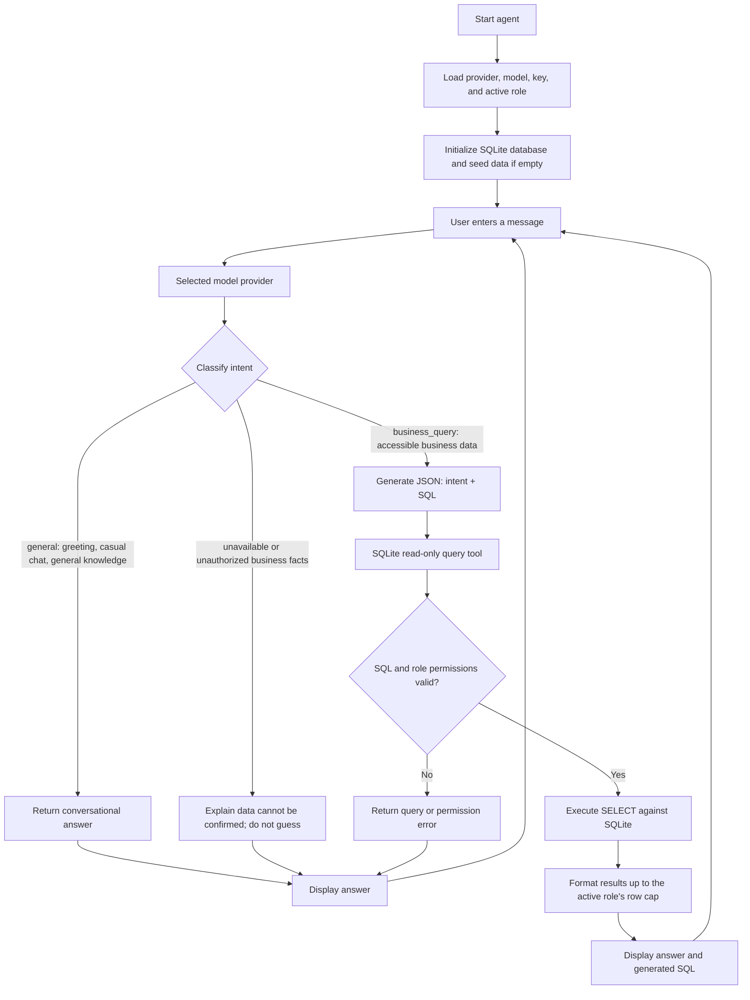

# Business Agent

A natural-language business agent with interchangeable language-model
providers. The default provider is Groq via its OpenAI-compatible API; Ollama
with `qwen3.5:2b` is also available. Both providers use the same intent-routing
interface: the model answers general questions directly or proposes a
read-only SQL query for accessible business data. Python enforces SQLite role
permissions and formats query results.

## Workflow



In short, **every message goes to the model first**. Only a message classified as
an accessible business-data query reaches SQLite. General conversation is answered
by the model directly, and the SQL tool enforces the active role's table
permissions, read-only access, query timeout, and result limit.

## Requirements

- Python 3.10+
- A Groq API key for the default provider, or Ollama with
  `qwen3.5:2b` installed for local inference.

## Setup (Windows PowerShell)

```powershell
py -3.10 -m venv .venv
.\.venv\Scripts\Activate.ps1
python -m pip install --upgrade pip
python -m pip install -e .
Copy-Item .env.example .env
```

Open `.env` locally and replace the `GROQ_API_KEY` placeholder with your Groq
API key. Never paste the key into source code, commit it, or send it in chat.
`.env` is excluded by `.gitignore`.

Default model settings are `MODEL_PROVIDER=groq` and
`GROQ_MODEL=openai/gpt-oss-20b`. Other Groq model IDs include
`openai/gpt-oss-120b` and `qwen/qwen3.8-27b`; availability and usage limits
depend on your Groq account. To switch back to local Ollama, set
`MODEL_PROVIDER=ollama` and configure `OLLAMA_HOST` and `OLLAMA_MODEL`. Both
implementations are behind the same `LanguageModel` interface in
`business_agent/llm.py`, so the agent and database logic do not need
provider-specific changes.
See the [Groq OpenAI-compatible API guide](https://console.groq.com/docs/openai)
and [model list](https://console.groq.com/docs/models) for current endpoint and
model details.
The CLI displays end-to-end response time for each question. Run the same
questions with each provider to compare; Groq timing includes internet latency,
and API usage is subject to Groq account limits and any applicable pricing.

Because an API key was previously pasted into chat, revoke that key in the Groq
console and create a replacement. Enter the replacement only in your local,
git-ignored `.env`.

The default database path is `data/business.db`. On first run, the app creates
the database and seeds 50 customers, 100 products, 1,000 orders, and their
order-line items. Existing orders are not re-seeded. Override settings with
environment variables or `.env`.

## Run

```powershell
python -m business_agent
```

When using the Groq provider, the computer needs internet access and the API
account's model limits and pricing apply. When using Ollama, make sure its
service is running and the configured model is already installed.

Choose a least-privilege role with `--role`:

```powershell
python -m business_agent --role customer_support
python -m business_agent --role inventory_manager
python -m business_agent --role sales_analyst
python -m business_agent --role admin
```

Roles:

- `customer_support`: internal customer-service staff; customers, orders, and
  order items; maximum 1,000 result rows per query.
- `inventory_manager`: internal inventory staff; products, order items, and
  order status; maximum 1,000 result rows per query.
- `sales_analyst`: internal sales staff; all business tables; maximum 1,000
  result rows per query.
- `admin`: read-only access to all business tables; maximum 1,000 result rows
  per query.

Every role is read-only. SQLite authorizer checks table access as queries execute,
and the query tool enforces each role's row cap (never greater than 1,000). A
new role defaults to a 100-row cap; internal roles explicitly opt into 1,000.
There is currently no customer-facing role. Before adding one, implement
customer-specific row-level access so one customer cannot read another
customer's records. The model receives the permitted schema and relationship
descriptions with every question. The CLI reports elapsed time for each request,
which can be used to compare providers. Type `exit` to leave the chat.

## Tests

```powershell
python -m unittest discover -s tests -v
```

## Golden-question evaluation

`evaluation/golden_questions.json` contains fixed natural-language questions,
the expected intent, and a golden SQL answer for business questions. The
expected answer values are checked against the seeded data in the unit tests.
To evaluate the configured model's intent routing and generated SQL against
those answers, run:

```powershell
python -m business_agent.evaluate
```

The evaluation creates a temporary database with the standard 50 customers,
100 products, and 1,000 orders, then removes it when finished. It uses the
provider and model configured in `.env`, so questions are sent to that model
and may incur API usage. It does not read or modify `data/business.db`.
