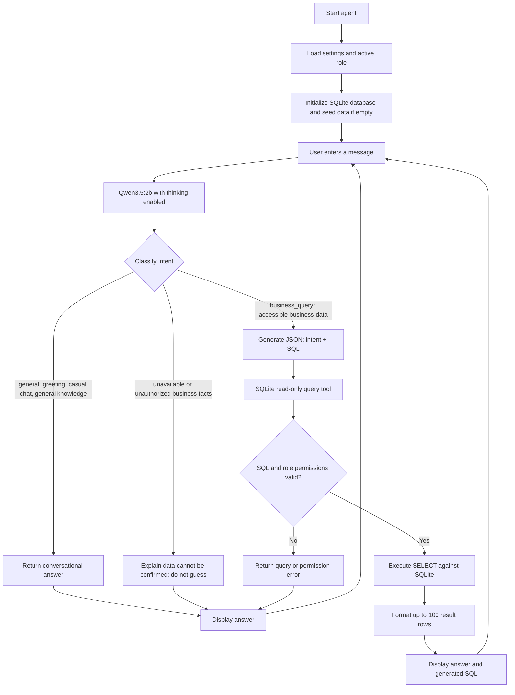

# Business Agent

A local natural-language agent using `qwen3.5:2b` with thinking enabled. The model
first classifies each input: business-data requests generate a read-only SQLite
query that is checked against role permissions; greetings and other general
questions receive a direct conversational answer without querying the database.
SQL query results are formatted directly to avoid inventing data. The model may
use up to 4,096 tokens for reasoning and output, so complex requests may take
longer.

## Workflow



In short, **every message goes to the model first**. Only a message classified as
an accessible business-data query reaches SQLite. General conversation is answered
by the model directly, and the SQL tool enforces the active role's table
permissions, read-only access, query timeout, and result limit.

## Requirements

- Python 3.10+
- Ollama running locally with `qwen3.5:2b` available

## Setup (Windows PowerShell)

```powershell
py -3.10 -m venv .venv
.\.venv\Scripts\Activate.ps1
python -m pip install --upgrade pip
python -m pip install -e .
Copy-Item .env.example .env
```

The default `.env` values use `http://localhost:11434`, model `qwen3.5:2b`, and
`data/business.db`. The first run creates the database and seeds 50 customers,
100 products, 1,000 orders, and their order-line items. Existing orders are not
re-seeded. Override settings with environment variables or `.env`.

## Run

```powershell
python -m business_agent
```

Make sure the Ollama service is running before starting the agent. The model
`qwen3.5:2b` is already installed on this computer, so no download is needed.
`ollama pull qwen3.5:2b` is only needed once if it is not installed; `ollama
serve` is only needed if the Ollama service is not already running.

Choose a least-privilege role with `--role`:

```powershell
python -m business_agent --role customer_support
python -m business_agent --role inventory_manager
python -m business_agent --role sales_analyst
python -m business_agent --role admin
```

Roles:

- `customer_support`: customers, orders, and order items.
- `inventory_manager`: products, order items, and order status.
- `sales_analyst`: all business tables.
- `admin`: read-only access to all business tables.

Every role is read-only. SQLite authorizer checks table access as queries execute,
and results are capped at 100 rows. The model receives the permitted schema and
relationship descriptions with every question. Type `exit` to leave the chat.

## Tests

```powershell
python -m unittest discover -s tests -v
```
